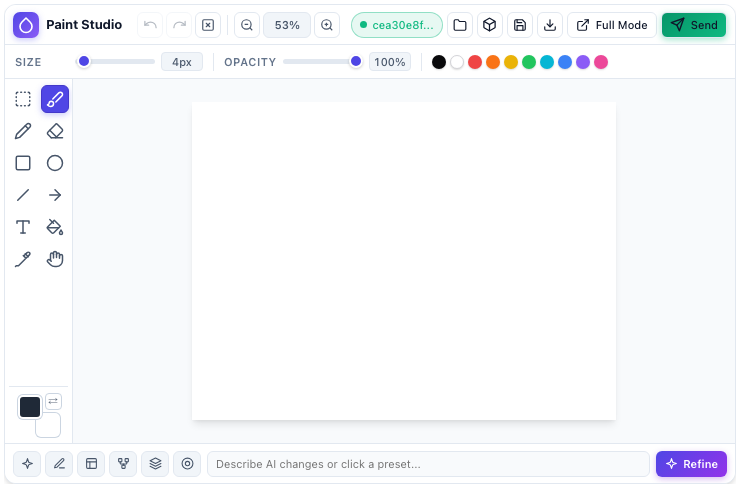
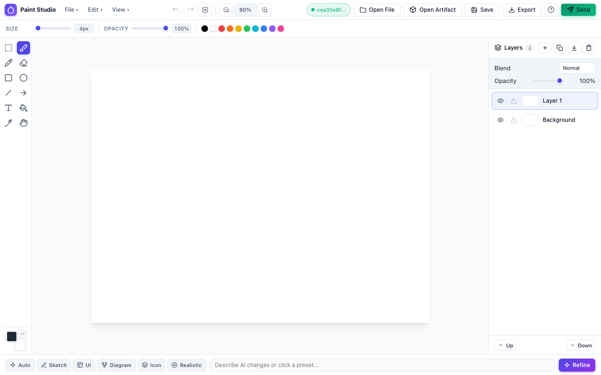

# Paint Studio (`agy-paint-studio`)

Paint Studio is a drawing and image editing UI extension for Google Antigravity. Use it in the side pane next to your conversation to sketch diagrams, annotate screenshots, edit multi-layer `.psd` files, and refine drawings with Gemini.



## Quickstart

### 1. Install the plugin

Link the repository into your Antigravity plugins directory and build the frontend:

```bash
ln -s /path/to/agy-paint-studio ~/.gemini/config/plugins/agy-paint-studio
cd /path/to/agy-paint-studio
npm install
npm run build
```

Enable **Paint Studio** in **Customizations → Installed**.

### 2. Enable AI refinement (optional)

AI refinement uses Google Cloud Application Default Credentials (ADC):

```bash
gcloud auth application-default login
export GOOGLE_CLOUD_PROJECT="your-gcp-project-id"
export GOOGLE_CLOUD_LOCATION="global"
```

### 3. Open Paint Studio

Open Paint Studio inline in the chat or in the right-hand side pane:

- Type `/paint-studio` in chat to get both an **inline canvas** in the conversation and a **Paint Studio** pill to dock it in the side pane.
- Open the **⋮** menu in the top-right corner of a conversation and choose **Extensions → Paint Studio** to toggle the side pane directly.
- Click any `.psd`, `.png`, `.jpg`, `.jpeg`, or `.webp` file link in chat or the file explorer to open it directly in Paint Studio.

Draw on the canvas and click **Send** to post the image into the active conversation.

---

## Inline, side pane, file viewer, and full mode

Paint Studio runs in four views served by its background sidecar:

- **Inline chat mode**: A 480px card embedded directly in the chat stream for quick sketches and annotations.
- **Side-pane mode**: A dockable panel in Antigravity's auxiliary side pane that automatically expands to the full workspace layout when widened or maximized.
- **Custom image & `.psd` file viewer** (`file_extensions: [".psd", ".png", ".jpg", ".jpeg", ".webp"]`): Clicking any supported image or `.psd` file in Antigravity opens it in Paint Studio ready for editing or annotation.
- **Full mode** (`?mode=full`): A full browser workspace with menu bars and a layer panel for managing multiple layers, blend modes, and opacity. Click **Full Mode** in the header to open it in a browser tab.



---

## Workflows and shortcuts

### Saving, exporting, and sending

| Action | Description |
| :--- | :--- |
| **Send** | Saves the current canvas as a PNG in the session folder and posts it to the active chat. |
| **Save (`⌘S`)** | Saves a layered `.psd` file to your local filesystem (`Downloads`, `Desktop`, `Workspace`, `Session`, or custom path). |
| **Export (`⇧⌘E`)** | Exports a flattened `PNG`, `JPEG`, or `WebP` image to your local filesystem. |
| **Open File (`⌘O`)** | Opens a local image (`PNG`, `JPEG`, `WebP`) or layered `.psd` file from disk. |
| **Open Artifact** | Browses images and `.psd` files from the active Antigravity session to open as a canvas or insert as a new layer. |

### AI refinement

The bottom bar refines your drawing and adds the result as a new layer:

- **Presets**: Click **Beautify**, **Notes**, **Watercolor**, **Concept Art**, **Vector**, **Pixel Art**, **3D Clay**, or **Anime** to transform the current canvas.
- **Custom prompt**: Type instructions in the prompt box and press `Enter` or click **Refine**.

### Keyboard shortcuts

| Key | Tool / Action |
| :--- | :--- |
| `V` | Select, move, cut, copy, or paste |
| `B` | Smooth brush |
| `P` | Pixel pencil |
| `E` | Eraser |
| `U` / `O` | Rectangle / Ellipse |
| `L` / `A` | Line / Arrow |
| `T` | Text |
| `G` | Paint bucket fill |
| `I` | Eyedropper |
| `H` / `Space` | Pan canvas (scroll to zoom) |
| `X` | Swap foreground and background colors |
| `[` / `]` | Decrease / increase tool size |
| `⌘Z` / `⇧⌘Z` | Undo / Redo |
| `⌫` | Clear active selection or layer |

---

## Development

Build the frontend, run the typechecker, and run the test suite:

```bash
npm run build
npm run typecheck
npm test
```

### Project layout

```text
agy-paint-studio/
├── plugin.json                        # Plugin manifest
├── sidecars/studio/                   # UI extension sidecar manifest and entrypoint
├── skills/paint-studio/               # /paint-studio inline + side-pane skill
├── server/                            # SidecarApp routes and Gemini service
├── src/                               # Canvas engine and UI components
├── assets/                            # Icons and documentation screenshots
└── tests/                             # Unit and server integration tests
```

---

## License

Licensed under the Apache License, Version 2.0. See [LICENSE](LICENSE) for details.

---

## Disclaimer

This is not an officially supported Google product.
